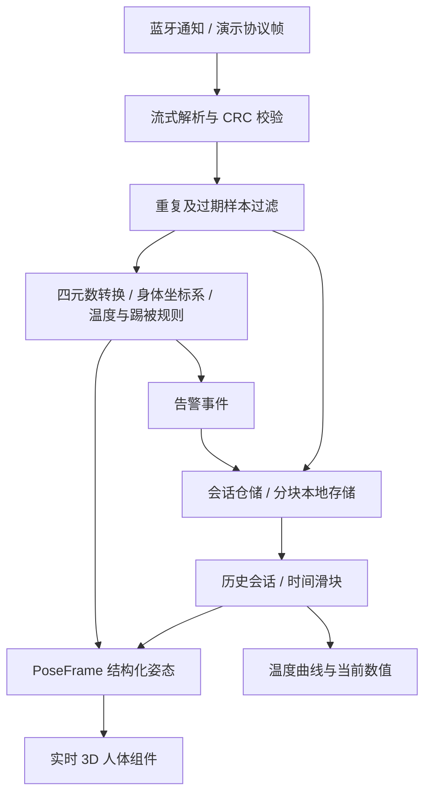

# BabyBand 工程化阶段交付说明

日期：2026-10-21。主项目：`/home/jaythan/projects/babyband-cli_new`。

## 当前架构



应用层四元数统一使用 `{w,x,y,z}`；数学层显式转换。渲染接口为 `{timestamp, rotations:{q0,q1,q2}, valid}`。无效姿态保持上一帧，避免 NaN 传到渲染器。

## 已修复

- 协议四元数对象与算法数组读法不一致；零范数、缺失与非有限数处理。
- CRC 失败继续进入算法；温度和姿态有效标志未使用。
- BLE 通知开启失败仍显示连接成功；重复帧、过期帧处理。
- 真实通知和定时器重复处理同一采样；不再伪造 90% 电量。
- 温差方向与注释、踢被规则不一致；页面消费实际算法结果，使用“疑似踢被”表述。
- 历史页重复方法覆盖；首页隐藏后演示定时器继续弹告警。
- 录制整段 JSON 一次写入与无错误提示；改为每 20 样本缓冲写入分块仓储，失败暂停并保留缓冲可重试。
- 历史会话兼容旧数据迁移；滑块同步姿态、选中时间、温度和曲线窗口。
- App renderjs 路径别名无法解析；3D 镜头过近裁切身体。

## 工程目录

- `src/types/`：JSDoc 契约、四元数与样本归一化。
- `src/services/`：样本接入接口。
- `src/repositories/`：存储端口、分块会话仓储、错误类型。
- `src/utils/protocol/`、`bluetooth/`、`algorithms/`：协议、BLE、算法实现。
- `src/utils/pose3d/`、`src/components/HumanPose3D/`：平台隔离的 3D 姿态组件。
- `src/pages/`：实时监测和历史回放接入。
- `tests/`：架构、功能、3D、页面集成回归测试。
- `docs/architecture/`、`docs/body3d/`、`docs/reviews/`：设计、依赖审查、资产来源与三个窗口的原始阶段报告。

原始阶段报告记录的是各窗口交付时的状态；本说明优先描述集成后的状态。算法现在直接支持对象四元数，页面已切换分块仓储，三平台构建均已执行，无需照阶段报告再重复进行旧的数组转换。

## 3D 项目选择与实际资产

使用 [微信官方 threejs-miniprogram](https://github.com/wechat-miniprogram/threejs-miniprogram)（查询时 799 stars，MIT，已克隆到 `/home/jaythan/projects/babyband-references/threejs-miniprogram`）。微信依赖固定为 `threejs-miniprogram@0.0.8`；H5/App 使用本地 three r149 资源，包含 MIT 许可证。

当前接入的是程序生成的婴儿比例几何关节模型，可用腰/腕/踝姿态驱动；不是外部扫描婴儿网格。单腕、单踝传感器不能测得所有关节，未测量部分采用简化估计。Anny（606 stars）与 MPFB2（648 stars）需要离线资产制作，本轮未转换或集成它们的模型。其余候选及选择依据见资产来源说明。

## 验证结果

已在 WSL Linux Node 环境执行：

| 命令 | 实际结果 |
| --- | --- |
| `npm test` | 122 通过，0 失败，0 跳过 |
| `npm run build:h5` | exit 0 |
| `npm run build:mp-weixin` | exit 0 |
| `npm run build:app` | exit 0 |

浏览器实际检查：3D 模型可显示；完成 37 样本录制、停止保存、历史读回；拖动回放滑块后，选取时间从 10:53:54 变为 10:54:26，姿态输入及温度数值联动。

未连接真实设备，未验证微信真机或 App 安装包运行。App 构建产物需由 HBuilderX 运行/打包；构建通过不是实机验收。

## 仍需完成的事项

1. **嵌入式协议确认**：企划书截图的 MsgType/Length 帧与当前固定长度解析器存在差异；CRC 类型与范围、字节序、FFE0/FFE1 UUID、状态位、q0/q1/q2 佩戴映射和序号回绕规则尚需确认。未猜测新字段偏移。设备在同一连接内重启后需要重置样本守卫。
2. **算法有效性**：现有踢被规则属于启发式实现，阈值、校准方法、安装方向和真实翻身分类尚需实测数据验证；3D 动起来不等于翻身识别已经可靠。
3. **数据功能**：当前落地为跨平台分块键值存储；App SQLite 只有接口边界与建表建议，尚未实现。企划书中的完整姿态片段、心率/血氧、温度融合和断线补传尚未全部完成；当前固件样本没有提供全部字段。
4. **依赖**：既有依赖审查报告记录 62 项告警（32 high / 16 moderate / 14 low，无 critical），未盲目升级 DCloud 工具链。Sass legacy API 与 Browserslist 警告仍存在。微信适配器依赖旧 three r108，小程序主包体积也需实机工具检查。
5. **持久化边界**：本地空间仍有总配额；分块不能消除空间限制。尚无完整会话删除/自动淘汰界面，异常退出可能遗留孤儿块；最多 19 个待批量写入样本可能在进程强制终止时丢失。
6. **材料边界**：企划书只核对了可见的 17–26 页截图，旧聊天只恢复到三条用户消息，未声称读过缺失全文。

## 启动与回滚

```sh
cd /home/jaythan/projects/babyband-cli_new
npm ci
npm run dev:h5 -- --host 0.0.0.0
# 浏览器打开 http://localhost:5173/
npm run dev:mp-weixin
# 微信开发者工具导入 dist/dev/mp-weixin
npm run build:app
# HBuilderX 导入 dist/build/app 运行/打包
```

原始工程保留为本地 Git 基线 `7df43d4`，三个隔离目录位于 `/home/jaythan/projects/babyband-parallel/`。未向 GitHub 推送或创建远程仓库。
